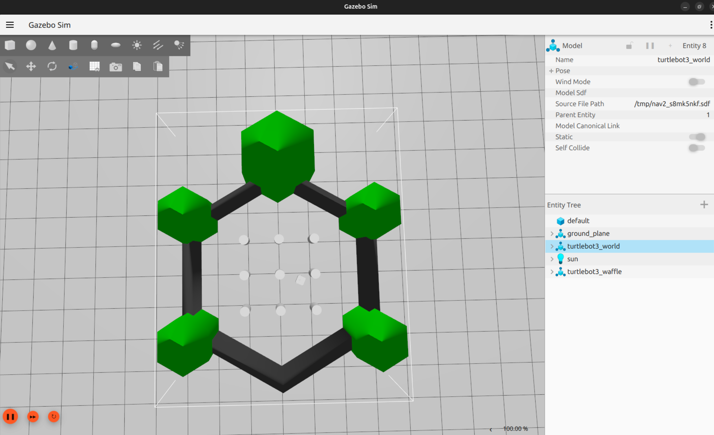

# TurtleBot3 Autonomous Navigation using ROS 2 Nav2

## Overview

This project demonstrates autonomous navigation of a simulated TurtleBot3 robot using ROS 2 Navigation2 (Nav2) in Gazebo, with RViz2 for visualization and goal selection.

The simulation uses the official ROS 2 Nav2 and TurtleBot3 simulation packages. The default navigation configuration is used without custom planners, controllers, or parameter modifications.

The objective was to bring up the navigation stack, verify the relevant ROS 2 topics, initialize the robot's pose, and demonstrate successful navigation to multiple goals.

## Technology Stack

- **Operating System:** Ubuntu 24.04 LTS
- **Middleware:** ROS 2 Jazzy
- **Simulator:** Gazebo Sim
- **Robot:** TurtleBot3
- **Navigation:** ROS 2 Navigation2 (Nav2)
- **Visualization:** RViz2
- **Localization:** AMCL using the provided map

## Installation

Update the package index and install the required ROS 2 packages:

```bash
sudo apt update

sudo apt install \
  ros-jazzy-navigation2 \
  ros-jazzy-nav2-bringup \
  ros-jazzy-nav2-minimal-tb\*
```

Source the ROS 2 environment:

```bash
source /opt/ros/jazzy/setup.bash
```

## Launch the Simulation

Start Gazebo, TurtleBot3, Nav2, and RViz2:

```bash
ros2 launch nav2_bringup tb3_simulation_launch.py headless:=False
```

Wait for the simulation and navigation components to initialize.

## Autonomous Navigation Procedure

1. Verify that the robot and environment are visible in Gazebo and RViz2.
2. Initialize the robot's estimated position using **2D Pose Estimate** in RViz2.
3. Allow the localization estimate to stabilize.
4. Select **Nav2 Goal** and specify a reachable destination on the map.
5. Observe the planned path and the robot's autonomous movement.
6. Repeat with additional goals and verify that navigation completes successfully.

## Validation

The following checks were performed during testing:

- Confirmed that the Gazebo simulation launched successfully.
- Verified the availability and publication of relevant ROS 2 sensor and odometry topics.
- Initialized the robot pose in RViz2.
- Sent multiple navigation goals through the RViz2 interface.
- Observed successful goal completion during the simulation.

## Demo

**Screen recording:** [https://youtu.be/PzXvrKjuCgg?si=HJFo-D8-o0CTQnWo]

The recording shows Gazebo and RViz2 side by side, robot localization, navigation goal selection, and autonomous movement toward the selected goals.

## Screenshot




## Configuration and Scope

This is a simulation integration and validation project using existing ROS 2 packages and their default navigation parameters. No custom navigation algorithm or Nav2 parameter tuning was implemented.

The project focuses on understanding and demonstrating the interaction between simulation, localization, path planning, control, and visualization.

## References

- [Nav2 Jazzy Quickstart](https://docs.nav2.org/jazzy/getting_started/quickstart/quickstart/)
- [Navigation2 Documentation](https://docs.nav2.org/)
- [ROS 2 Documentation](https://docs.ros.org/en/jazzy/)
